# 🛡️ PromptShield AI

**Detecting prompt-injection and jailbreak attempts with fine-tuned language models**


-8a2be2)


PromptShield AI classifies an English prompt as **Safe** or **Attack** before it reaches a language model. "Attack" covers prompt injection (overriding instructions, extracting hidden instructions or secrets) and jailbreaks (removing a model's safety rules). The project compares four detectors on a carefully audited dataset, with a leakage-safe train/validation/test split, thresholds frozen on validation, and a test set that was scored exactly once.

The emphasis is on **evaluation you can trust**: data quality was investigated rather than assumed, every correction is traceable to the original label, and each result comes with a confidence interval and a list of its limitations.

---

## Contents

1. [At a glance](#at-a-glance)
2. [Demo app](#demo-app)
3. [Project pipeline](#project-pipeline)
4. [Data](#data)
5. [Models and training](#models-and-training)
6. [Evaluation protocol](#evaluation-protocol)
7. [Results](#results)
8. [Limitations](#limitations)
9. [Run the app locally](#run-the-app-locally)
10. [Reproduce the experiments](#reproduce-the-experiments)
11. [Repository structure](#repository-structure)
12. [Future work](#future-work)
13. [Licences, sources and references](#licences-sources-and-references)

---

## At a glance

| | |
|---|---|
| **Task** | Binary classification of English prompts: `safe` vs `attack` |
| **Data** | 24,011 prompts from three public datasets, after auditing and cleaning (train 17,413, validation 3,298, test 3,300) |
| **Models** | TF-IDF + logistic regression, DistilBERT, Qwen2.5-1.5B with LoRA, Qwen2.5-1.5B with QLoRA |
| **Best test result** | Qwen LoRA/QLoRA: about **89% of attacks caught** at a **1.1% to 1.3%** false-positive rate on safe prompts |
| **Cheapest option** | DistilBERT: 8x lower latency and about 20x less memory than Qwen, with a modest accuracy gap |
| **Efficiency finding** | QLoRA matched LoRA's accuracy with **49% less inference memory** (21% less during training) |
| **Test discipline** | Checkpoints and cut-offs chosen on validation only; test split scored once; 95% bootstrap intervals over prompt families |

---

## Demo app

A small Streamlit app runs the DistilBERT detector. Paste a prompt (or pick one of six examples), press **Analyze**, and it shows **SAFE** or **ATTACK** together with the attack score, the decision threshold, and the model name.


- A prompt is labelled **ATTACK** when its attack score is **above the decision threshold** (0.7821 for DistilBERT), the same rule used in the evaluation.
- The threshold is read from `results/tables/thresholds_from_validation.csv`; it was chosen on the validation set and never changed afterwards.
- The attack score is a **model output between 0 and 1, not a calibrated probability** (calibration was not verified).
- The app code does not store prompts. Empty input and prediction errors are handled with plain messages.

See [Run the app locally](#run-the-app-locally).

---

## Project pipeline

```mermaid
flowchart LR
    A["3 public datasets<br/>26,098 prompts"] --> B["Unified schema, stable ids<br/>SHA256 manifest"]
    B --> C["Quality flags<br/>duplicates, length, language"]
    C --> D["Label review<br/>rules, similarity search, audit"]
    D --> E["dataset_v2<br/>24,011 prompts"]
    E --> F["Group-aware split<br/>train / val / test"]
    F --> G["TF-IDF, DistilBERT,<br/>Qwen LoRA, Qwen QLoRA"]
    G --> H["Validation: pick checkpoint,<br/>freeze threshold"]
    H --> I["Test: scored once,<br/>bootstrap intervals"]
    I --> J["Streamlit demo"]
```



---

## Data

### Sources

| Source | Licence shown on its page* | Contribution (before filtering) |
|---|---|---|
| [deepset/prompt-injections](https://huggingface.co/datasets/deepset/prompt-injections) | Apache-2.0 | 662 short human-written prompts |
| [xTRam1/safe-guard-prompt-injection](https://huggingface.co/datasets/xTRam1/safe-guard-prompt-injection) | none found when checked | 10,296 synthetic prompts, generated with GPT-3.5-turbo according to the dataset's description |
| [TrustAIRLab/in-the-wild-jailbreak-prompts](https://huggingface.co/datasets/TrustAIRLab/in-the-wild-jailbreak-prompts) (`jailbreak_2023_12_25` and `regular_2023_12_25`) | MIT | 1,405 jailbreak and 13,735 regular prompts collected from Reddit, Discord and websites (Dec 2022 to Dec 2023) |

\*As displayed on the dataset pages in November 2026. **Prompt text is not redistributed in this repository**: one source shows no licence, and many prompts are explicit. `data/dataset_v2_labels.csv` contains every row's id, source, original label, final label, provenance and split, so the full dataset can be rebuilt by downloading the sources and joining on `source_dataset` and `source_row_id`.

### What was found, and what was done

The first merged table had 26,098 rows (21,284 safe, 4,814 attack). Instead of trusting the labels, the data was investigated:

| Step | Finding | Action |
|---|---|---|
| Raw files fingerprinted | n/a | SHA256 manifest in `data/raw_manifest.json` proves the raw data was never altered |
| Unified schema | Each source uses different columns and labels | Stable row ids; **the original label is kept untouched** next to any later change |
| Duplicates | 2,337 rows share their text with another row; 48 texts carry both a safe and an attack label | Flagged; duplicate families later kept together in one split |
| Jailbreaks hidden in "safe" data | The same jailbreak text appeared as attack in one source and safe in another; about 12% of the "regular" prompts contained jailbreak-style phrases; a TF-IDF similarity search against known jailbreaks found more | Exact copies of known jailbreaks relabelled `attack`; uncertain similar prompts set aside as `ambiguous` |
| Harmless prompts labelled attack | Ordinary "act as a translator / interviewer" prompts were labelled attack in one source | Corrected to `safe` (kept as useful hard negatives) |
| Role-play character cards | 1,819 `{{user}}` / `{{char}}` templates whose label is arbitrary | Set aside as `ambiguous` |
| Random audit | 150 rows read by hand: 3 of 100 sampled "safe" rows were clearly real jailbreaks (2 more unsure); in the jailbreak-labelled source 2 of 30 sampled rows were clearly harmless and several more questionable | Estimated error rates documented under [Limitations](#limitations) |
| Language | Chinese, Russian, Hindi and similar scripts (164 rows) and German (174 rows) | Excluded: the project is English-only |

Every correction records **who decided it** (`label_source`) and **how sure it is** (`review_status`). Provisional corrections were made with AI-assisted review (Claude) and are not independently human-verified. Rows whose label could not be defended were never forced into a class.

The data cleaning code is in `src/pipeline.py` and notebooks `01` to `03`. Labelling rules (first draft) are in `docs/annotation_guidelines.md`.

### Final dataset (`dataset_v2`)

| Split | Attack | Safe | Total |
|---|---:|---:|---:|
| Train | 3,727 | 13,686 | 17,413 |
| Validation | 669 | 2,629 | 3,298 |
| Test | 671 | 2,629 | 3,300 |
| **Total** | **5,067** | **18,944** | **24,011** |

**Leakage-safe split.** Reposted prompts and near-copies are common (DAN variants, templated attacks). A random split would put copies on both sides and inflate scores. Each prompt was therefore given a family name from its normalised first 40 characters, and the split keeps every family on one side (`StratifiedGroupKFold`, 7 folds, seed 42: fold 0 test, fold 1 validation). Two very large families (about 875 prompts) were placed in training so they could not dominate the validation or test set.

---

## Models and training

| | TF-IDF + LR | DistilBERT | Qwen2.5-1.5B + LoRA | Qwen2.5-1.5B + QLoRA |
|---|---|---|---|---|
| Method | word and bigram TF-IDF (200k features), logistic regression | full fine-tuning of `distilbert-base-uncased` | LoRA adapters on a frozen 16-bit base, plus a trained 2-class head | same, with the base stored in 4-bit NF4 (double quantisation) |
| Trainable parameters | n/a | all (about 66M) | **4,361,216 (0.28%)** | **4,361,216 (0.28%)** |
| Learning rate | n/a | 2e-5 (constant) | 2e-4, 3% warm-up, linear decay | 2e-4, 3% warm-up, linear decay |
| Batch size | n/a | 16 | 8 x 2 accumulation (16) | 8 x 2 accumulation (16) |
| Epochs | n/a | 3 | 2 | 2 |
| Max length | first 3,000 characters | 256 tokens | 256 tokens | 256 tokens |
| Precision | n/a | fp32 | fp16 mixed precision | fp16 compute, 4-bit weights |
| Hardware | MacBook Air M5 | MacBook Air M5 (Apple GPU) | Google Colab T4 | Google Colab T4 |
| Selected checkpoint | n/a | epoch 2 | epoch 2 | epoch 1 |

LoRA settings: rank 16, alpha 32, dropout 0.05, applied to the attention projections `q_proj`, `k_proj`, `v_proj` and `o_proj`. The classification head is trained in full precision. Both Qwen runs use the same settings, seed (42) and data order; only the base-model loading differs, so any difference in results, time or memory comes from 4-bit storage. No class weights were used for any model. Hyperparameters are standard starting values and were **not tuned**.

Checkpoints were selected by **validation average precision** (a threshold-free metric). DistilBERT's checkpoint was selected earlier by F1 (epoch 2 either way; see [Limitations](#limitations)).

---

## Evaluation protocol

1. **Validation set** was used to choose checkpoints, to compare models at matched false-positive rates, and to set each model's cut-off.
2. **Cut-offs were frozen on validation**: for each model, the score above which 1% of validation safe prompts are flagged (DistilBERT 0.7821, Qwen LoRA 0.5115, Qwen QLoRA 0.7834, TF-IDF 0.3548). The rule is: flag a prompt as Attack when its score is above the cut-off. The saved values are in `results/tables/thresholds_from_validation.csv`.
3. **Loading checks before scoring.** Before touching the test set, each checkpoint had to reproduce its saved validation probabilities (maximum difference 0.000001 or smaller) or the run would stop.
4. **The test set was scored once**, only with the four selected checkpoints and frozen cut-offs. The inference notebooks save per-prompt scores and compute no metrics; metrics come afterwards in a separate notebook.
5. **Confidence intervals** use 1,000 bootstrap resamples of whole prompt families (not single rows, which would give intervals that are too narrow), drawn identically for all four models so that differences between models are paired.
6. All per-prompt scores are included in `results/tables/`, so every metric can be recomputed.

---

## Results

### Test set (3,300 prompts, scored once; 95% intervals)

Cut-offs frozen on validation (1% false-positive target).

| | TF-IDF + LR | DistilBERT | Qwen LoRA | Qwen QLoRA |
|---|---|---|---|---|
| **Average precision** | 0.949 [0.922, 0.968] | 0.965 [0.947, 0.978] | 0.971 [0.957, 0.983] | **0.972** [0.958, 0.982] |
| **Attack recall** | 0.851 [0.798, 0.894] | 0.855 [0.808, 0.898] | **0.894** [0.854, 0.929] | 0.885 [0.841, 0.920] |
| **Precision** | 0.928 [0.895, 0.954] | 0.936 [0.906, 0.958] | 0.946 [0.924, 0.965] | **0.952** [0.931, 0.968] |
| **Safe prompts flagged** | 44 of 2,629 | 39 | 34 | 30 |
| **False-positive rate** | 1.7% [1.1, 2.3] | 1.5% [1.0, 2.1] | 1.3% [0.8, 1.9] | 1.1% [0.8, 1.6] |
| **F1** | 0.888 | 0.894 | **0.920** | 0.917 |

<details>
<summary><b>Same models at the default 0.5 cut-off</b></summary>

| | TF-IDF + LR | DistilBERT | Qwen LoRA | Qwen QLoRA |
|---|---|---|---|---|
| Attack recall | 0.808 | 0.912 | 0.894 | 0.917 |
| Precision | 0.966 | 0.895 | 0.945 | 0.928 |
| F1 | 0.880 | 0.903 | 0.919 | 0.922 |
| Safe prompts flagged | 19 | 72 | 35 | 48 |

The models' scores sit on different scales, so a single 0.5 cut-off is not a fair way to compare them. This is why cut-offs were set on validation.
</details>

<details>
<summary><b>Which differences are real? (paired bootstrap, 95% intervals)</b></summary>

| Comparison | Metric | Difference | 95% interval | Excludes 0? |
|---|---|---:|---|:---:|
| Qwen LoRA minus DistilBERT | average precision | +0.007 | [-0.000, 0.014] | no |
| Qwen LoRA minus DistilBERT | recall | +0.039 | [0.015, 0.067] | **yes** |
| Qwen QLoRA minus DistilBERT | average precision | +0.007 | [-0.000, 0.017] | no |
| Qwen QLoRA minus DistilBERT | recall | +0.030 | [0.007, 0.057] | **yes** |
| Qwen LoRA minus Qwen QLoRA | average precision | -0.000 | [-0.006, 0.005] | no |
| Qwen LoRA minus Qwen QLoRA | recall | +0.009 | [-0.013, 0.031] | no |
| Qwen LoRA minus TF-IDF | average precision | +0.023 | [0.012, 0.038] | **yes** |
| Qwen LoRA minus TF-IDF | recall | +0.043 | [0.017, 0.075] | **yes** |
| DistilBERT minus TF-IDF | average precision | +0.016 | [0.005, 0.031] | **yes** |
| DistilBERT minus TF-IDF | recall | +0.004 | [-0.023, 0.034] | no |
</details>

<details>
<summary><b>Results by data source (test set, frozen cut-offs)</b></summary>

| Source | Attack prompts | TF-IDF caught | DistilBERT caught | Qwen LoRA caught | Qwen QLoRA caught |
|---|---:|---:|---:|---:|---:|
| `safeguard` (synthetic, repetitive) | 425 | 95.1% | 94.6% | 96.7% | 96.7% |
| `itw_jailbreak` (real, noisier labels) | 192 | 71.9% | 72.4% | 76.6% | 75.0% |
| `deepset` | **28** | 10.7% | 39.3% | 64.3% | 50.0% |
| `itw_regular` (mostly safe) | 26 | 100% | 84.6% | 92.3% | 96.2% |

Safe prompts wrongly flagged: `itw_regular` 2.8% / 2.5% / 2.1% / 1.9% (of 1,549) for TF-IDF, DistilBERT, LoRA and QLoRA; `safeguard` and `deepset` at most 1 prompt each. Nearly all false positives are in `itw_regular`, the source where the audit found hidden jailbreaks (see [Limitations](#limitations)). `deepset` has only 28 attack prompts, so its percentages move by 3.6 points per prompt.
</details>

### Validation set (used for selection, not for reporting)

| | Average precision | Attack recall at 1% safe flagged |
|---|---:|---:|
| TF-IDF + LR | 0.953 | 0.815 |
| DistilBERT (epoch 2) | 0.966 | 0.846 |
| Qwen LoRA (epoch 2) | 0.973 | 0.859 |
| Qwen QLoRA (epoch 1) | 0.972 | 0.849 |

### Cost: training and inference

| | DistilBERT | Qwen + LoRA | Qwen + QLoRA |
|---|---:|---:|---:|
| Training time per epoch | about 11 min (Apple GPU, fp32)\* | 30.8 min (T4) | 33.0 min (T4) |
| Peak GPU memory in training | not measured | 9.03 GB | **7.15 GB** |
| Model in GPU memory (inference) | 0.15 GB | 3.11 GB | **1.20 GB** |
| Peak memory at inference, batch of 32 | 0.33 GB | 3.88 GB | **1.98 GB** |
| Latency, one prompt (median / 95th percentile) | **7.5 / 14.7 ms** | 60.3 / 74.1 ms | 97.3 / 129.6 ms |
| Throughput, batch of 32 | **660 prompts/s** | 25.0 | 21.9 |
| Saved adapter size | n/a (full model, 268 MB) | 17.5 MB | 17.5 MB |

\*DistilBERT was trained on a different machine, so its training time is not comparable with the T4 numbers. Inference was benchmarked on a Colab T4 (640 validation prompts, fp16 math, tokenisation excluded, adapters unmerged; DistilBERT timed with pretrained weights, which does not change its speed). Free Colab GPUs vary, so differences under about 10% are noise.

### What the results support

1. **Both Qwen models beat the word-counting baseline**: average precision +0.02 and recall +4 points, with intervals excluding zero.
2. **Qwen has a modest edge over DistilBERT in recall at the chosen operating point** (+3 to +4 points, intervals exclude zero), and flagged fewer safe prompts. In average precision the edge is only +0.007 and its interval touches zero, so it is a trend, not a result.
3. **LoRA and QLoRA are indistinguishable** on every metric. QLoRA gave up no measurable accuracy while using 49% less memory at inference.
4. **QLoRA's price is speed:** 61% higher latency for a single prompt (97 vs 60 ms), but only 12% lower throughput at batch 32.
5. **The accuracy gain over DistilBERT costs about 8x the latency and 20x the memory.** For a low-latency guard in front of a chatbot, DistilBERT is the pragmatic choice; Qwen + QLoRA suits accuracy-first use with limited GPU memory.

---

## Limitations

This is a research prototype. Read the numbers with the following in mind.

- **Labels are partly noisy.** A random audit found about 3% of "safe" prompts in the `itw_regular` source were clearly real jailbreaks, and a sizeable share of the jailbreak-labelled source looked harmless or ambiguous (2 of 30 sampled clearly harmless, 6 more questionable; the true range is wide). Reported false-positive rates are therefore **upper bounds**, and recall on the jailbreak source is partly capped by label noise. Comparisons *between* models are more reliable than absolute rates, because the noise affects all models alike.
- **Corrections are AI-assisted and provisional.** They are traceable (`label_source`, `review_status`) but were not verified by a second human annotator.
- **Generalisation to unseen attack styles is not measured.** The test set comes from the same sources as the training data. The split separates near-copies, but families can still overlap. Cross-source and leave-one-family-out experiments were considered and not run.
- **One training run per model.** The intervals cover test-set sampling, not training randomness (seed variation).
- **One source is easy.** `safeguard` is synthetic and repetitive and supplies 63% of the test attacks (425 of 671), which lifts the overall numbers. Check the per-source table.
- **`deepset` has 28 test attack prompts**, so its per-source results are very uncertain.
- **Cut-offs transferred imperfectly.** A 1% target on validation became 1.1% to 1.7% on test; TF-IDF's interval lies above the target.
- **The attack score is not a calibrated probability.** Scores saturate near 0 and 1 and calibration was not verified.
- **English only, and only the first 256 tokens are read** (about 28% of prompts are longer).
- **Binary labels only.** The system does not distinguish jailbreaks from injections, and it does not handle indirect injection (instructions hidden in retrieved documents or tool outputs).
- **Comparison caveats.** DistilBERT was trained on different hardware and precision (so its training time is not comparable), and its checkpoint was selected by F1 rather than average precision.
- **A "Safe" result is not a security guarantee.** The model can miss attacks and flag harmless prompts. It should be one layer of defence among several.

---

## Run the app locally

```bash
git clone https://github.com/<your-username>/prompt-guard-detector.git
cd prompt-guard-detector

conda create -n promptshield-app python=3.11 -y
conda activate promptshield-app
pip install -r requirements.txt

streamlit run app.py
```

The app opens at `http://localhost:8501`.

**Model weights.** The DistilBERT weights (268 MB) are too large for Git. Put the checkpoint folder at `models/distilbert_v2/` (it must contain `config.json`, `model.safetensors` and the tokenizer files), or set the environment variable `PROMPTSHIELD_DISTILBERT_REPO` to a Hugging Face repository that contains it. The two Qwen models appear in the registry but are disabled, because they need an NVIDIA GPU.

`python scripts/check_predictor.py` reproduces 200 saved validation scores through the app's own code. It needs the full `dataset_v2.csv`, which you can rebuild locally (see below).

---

## Reproduce the experiments

Two environments were used: a local conda environment (Python 3.11, `torch 2.15.0`, `transformers 5.23.0`) on a MacBook Air, and Google Colab with a T4 GPU for the Qwen runs.

| Notebook | Where it ran | Purpose |
|---|---|---|
| `01_download_data` | local | Download the source datasets into `data/raw/` |
| `02_merge_and_label` | local | First merge (superseded by `03`) |
| `03_label_pipeline` | local | Staged data pipeline (manifest, quality flags, duplicates, rules, audit, splits) and the TF-IDF baseline |
| `04_baseline_distilbert` | local | DistilBERT training, threshold analysis, matched false-positive comparison |
| `05_qwen_lora` | Colab T4 | Qwen2.5-1.5B + LoRA training |
| `06_qwen_qlora` | Colab T4 | Qwen2.5-1.5B + QLoRA training (same code, 4-bit base) |
| `07_inference_benchmark` | Colab T4 | Latency, throughput and memory benchmark |
| `08_validation_comparison` | local | Validation comparison, calibration table, cut-off selection |
| `09_test_inference_qwen` | Colab T4 | Score the test split with the two Qwen checkpoints (no metrics) |
| `10_test_inference_mac` | local | Score the test split with DistilBERT and the refitted TF-IDF model |
| `11_final_evaluation` | local | Final metrics and bootstrap intervals |

To rebuild the dataset: run `01` to download the sources, check them with `verify_manifest` in `src/pipeline.py` against `data/raw_manifest.json` (a mismatch means a source changed upstream), then run `03`. `data/dataset_v2_labels.csv` lists every row's final label, provenance and split for comparison. Notebooks `01` to `04` are saved without outputs, because the data contains explicit prompts.

---

## Repository structure

```
prompt-guard-detector/
├── app.py                         Streamlit demo (UI only)
├── promptshield/                  model registry and predictor used by the app
├── scripts/check_predictor.py     checks the app's predictor against saved validation scores
├── src/pipeline.py                data pipeline functions (manifest, merge, quality flags)
├── notebooks/                     experiments, in order (01 to 11)
├── results/tables/                per-prompt scores, thresholds, metric tables, benchmarks
├── data/
│   ├── dataset_v2_labels.csv      final labels, provenance and splits (no prompt text)
│   └── raw_manifest.json          SHA256 fingerprints of the raw downloads
├── adapters/                      LoRA and QLoRA adapters (17.5 MB each)
├── docs/                          annotation guidelines, screenshots
├── requirements.txt
└── README.md
```

Not in the repository: the raw and processed datasets (they contain prompt text), and model weights over 100 MB.

---

## Future work

- Measure **generalisation to unseen attack styles** (leave-one-family-out, cross-source evaluation).
- Add a small **human-verified test set** with independently labelled prompts.
- Check **calibration** and, if needed, add temperature scaling.
- Repeat training with **several seeds** and report seed variance.
- Add **three-class labels** (safe, jailbreak, injection) and **indirect injection** examples (instructions inside documents and tool outputs).
- Merge the LoRA adapter into the base weights and measure the latency difference.
- Publish the DistilBERT weights and deploy the app publicly.

---

## Licences, sources and references

- **Code:** MIT License (see `LICENSE`).
- **Datasets** keep the licences of their sources (table under [Data](#data)); credit goes to their authors. The prompt text is not redistributed here.
- **Model weights and adapters** are derived from public base models (`distilbert-base-uncased`, `Qwen/Qwen2.5-1.5B`) and from the datasets above. Check the base-model and dataset licences before reusing them.
- **Responsible use.** The data contains offensive and explicit prompts. This is defensive research: the model detects attacks and does not generate any.

References:

- Shen, X., Chen, Z., Backes, M., Shen, Y., Zhang, Y. *"Do Anything Now": Characterizing and Evaluating In-The-Wild Jailbreak Prompts on Large Language Models.* ACM CCS 2024 (the in-the-wild jailbreak dataset).
- deepset, *prompt-injections* dataset, Hugging Face.
- xTRam1, *safe-guard-prompt-injection* dataset, Hugging Face (arXiv:2402.13064).
- Sanh, V., et al. *DistilBERT, a distilled version of BERT.* 2019.
- Hu, E., et al. *LoRA: Low-Rank Adaptation of Large Language Models.* 2021.
- Dettmers, T., et al. *QLoRA: Efficient Finetuning of Quantized LLMs.* 2023.
- Qwen Team. *Qwen2.5* model family.

